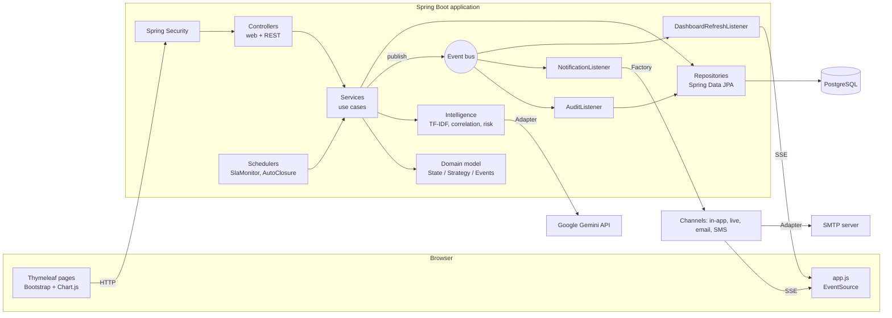
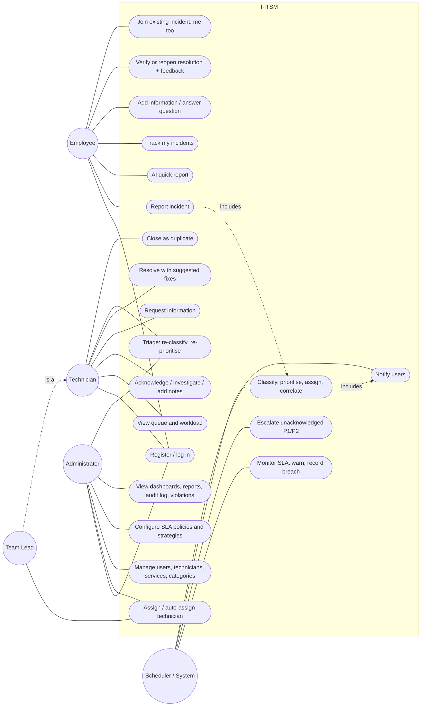
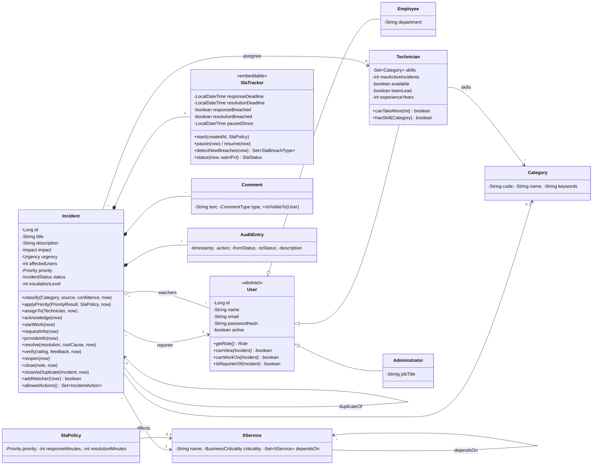
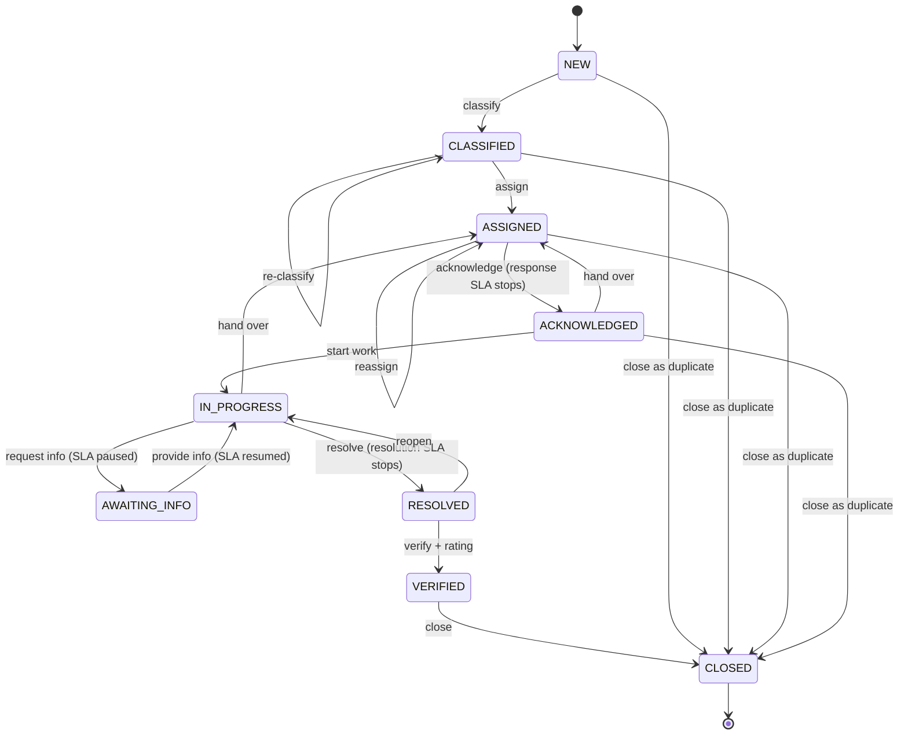
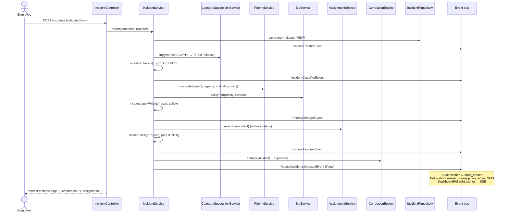

# I-ITSM: Design Documentation

This document is the source for the report's *System Architecture*, *UML*, *Database Design* and
*Algorithms* sections. Diagrams use Mermaid: they render on GitHub and in most Markdown viewers, and
can be exported as images from https://mermaid.live.

---

## 1. Problem analysis (summary)

**Problem.** IT incidents reported by email or phone get lost, are prioritised by gut feeling, land on
overloaded technicians, miss SLAs unnoticed, and leave no history.

**Stakeholders.** Employees (report and track), technicians (investigate and resolve), team leads
(first escalation point), IT manager/administrators (configure, monitor, report), and the
organisation (service availability, SLA compliance).

**Proposed solution.** A web platform that automates triage (classification, priority, SLA,
assignment), enforces a controlled lifecycle, monitors SLAs in the background, notifies the right
people, keeps a complete audit trail, and adds intelligence (duplicates, correlation, risk prediction,
suggested fixes).

**Assumptions.**
* Every incident affects exactly one IT service, chosen by the reporter (staff can correct it).
* SLA clocks run 24×7 (no business-hours calendar); time waiting for the reporter is excluded.
* A team lead is a technician with a flag, not a separate role.
* Email/SMS may be simulated; the design allows real gateways (Adapter).

---

## 2. Requirements

### Functional (selection)
| ID | Requirement |
|---|---|
| FR1 | Employees register, log in, report incidents, track status, add information, answer questions, verify or reopen fixes and give feedback |
| FR2 | The system classifies, prioritises, applies an SLA and assigns a technician automatically |
| FR3 | Technicians view their queue and workload, acknowledge, investigate, add notes, request information and resolve |
| FR4 | Administrators manage users, technicians, services, categories, SLA policies and strategies, and view reports, audit logs and violations |
| FR5 | Lifecycle transitions are validated; illegal transitions are rejected |
| FR6 | SLA deadlines are tracked; warnings and violations are detected in the background |
| FR7 | Relevant users are notified through several channels |
| FR8 | Every action is audited with timestamp, user, action, previous/new state and description |
| FR9 | Incidents are searchable by at least 5 criteria; dashboards and reports are available |
| FR10 | At least two intelligent features (seven implemented) |

### Non-functional
| ID | Requirement | How it is met |
|---|---|---|
| NFR1 Security | Authentication, RBAC, hashed passwords, CSRF, input validation | Spring Security, BCrypt, Bean Validation, service-level ownership checks |
| NFR2 Maintainability | New categories/strategies/channels without redesign | Categories are data; Strategy/Factory/Observer patterns |
| NFR3 Reliability | No lost updates; audit consistent with changes | Transactions, optimistic locking (`@Version`), audit written in the same transaction |
| NFR4 Availability of AI | App works without AI | Offline TF-IDF fallback behind the same interface |
| NFR5 Performance | Pages < 1 s at demo scale | Indexed columns, batch fetching, aggregate queries |
| NFR6 Usability | Different UI per role, live feedback | Role themes, live analysis panel, toasts |

### Business rules
1. Priority = f(impact, urgency, criticality, affected users) by the active algorithm (§6.1).
2. A service-specific SLA policy overrides the default for that priority.
3. Response SLA stops at ACKNOWLEDGED; resolution SLA stops at RESOLVED; AWAITING_INFO time is excluded.
4. A technician cannot exceed their workload limit unless an administrator overrides it.
5. Only the assignee, a team lead or an admin may do technician work; only the reporter (or admin) may verify or reopen.
6. Unacknowledged P1/P2 incidents escalate one level per elapsed response window, up to the IT manager.
7. A reporter cannot open a near-identical incident on the same service twice without confirming it is different.

---

## 3. Architecture



Layered monolith: dependencies point downwards only; the domain layer has no Spring or web imports
apart from JPA mapping annotations.

---

## 4. UML

### 4.1 Use case diagram



### 4.2 Class diagram: domain core



### 4.3 Class diagram: patterns

```mermaid
classDiagram
    class IncidentState {
        <<interface>>
        +status() IncidentStatus
        +allowedActions() Set
        +assign() IncidentState
        +acknowledge() IncidentState
        +resolve() IncidentState
        +close() IncidentState
    }
    IncidentState <|.. NewState
    IncidentState <|.. ClassifiedState
    IncidentState <|.. AssignedState
    IncidentState <|.. AcknowledgedState
    IncidentState <|.. InProgressState
    IncidentState <|.. AwaitingInfoState
    IncidentState <|.. ResolvedState
    IncidentState <|.. VerifiedState
    IncidentState <|.. ClosedState

    class PriorityCalculator { <<interface>> +calculate(PriorityInput) PriorityResult }
    PriorityCalculator <|.. WeightedPriorityCalculator
    PriorityCalculator <|.. MatrixPriorityCalculator
    PriorityService o-- PriorityCalculator

    class AssignmentStrategy { <<interface>> +rank(Incident, List) List; +select(...) Optional }
    class AbstractAssignmentStrategy { <<abstract>> +rank() final; #order()* }
    AssignmentStrategy <|.. AbstractAssignmentStrategy
    AbstractAssignmentStrategy <|-- SkillBasedAssignmentStrategy
    AbstractAssignmentStrategy <|-- LoadBasedAssignmentStrategy
    AbstractAssignmentStrategy <|-- RoundRobinAssignmentStrategy
    AbstractAssignmentStrategy <|-- SmartAssignmentStrategy
    AssignmentService o-- AssignmentStrategy

    class IncidentEvent { <<abstract>> +auditAction()* ; +describe()* ; +recipients(); +channels(); +severity() }
    IncidentEvent <|-- IncidentCreatedEvent
    IncidentEvent <|-- IncidentAssignedEvent
    IncidentEvent <|-- IncidentStatusChangedEvent
    IncidentEvent <|-- SlaBreachedEvent
    IncidentEvent <|-- IncidentEscalatedEvent
    IncidentEvent <|-- RelatedIncidentsDetectedEvent
    AuditListener ..> IncidentEvent : observes
    NotificationListener ..> IncidentEvent : observes

    class NotificationChannel { <<interface>> +type() ChannelType; +send(NotificationMessage) }
    NotificationChannel <|.. InAppNotificationChannel
    NotificationChannel <|.. LivePushNotificationChannel
    NotificationChannel <|.. EmailNotificationChannel
    NotificationChannel <|.. SmsNotificationChannel
    NotificationChannelFactory o-- NotificationChannel
    NotificationListener --> NotificationChannelFactory
    EmailNotificationChannel --> EmailGateway
    class EmailGateway { <<interface>> }
    EmailGateway <|.. SmtpEmailGateway : adapts JavaMailSender

    class LlmClient { <<interface>> +generateJson(prompt) String }
    LlmClient <|.. GeminiLlmClient : adapts Gemini REST
    class CategoryClassifier { <<interface>> }
    CategoryClassifier <|.. KeywordCategoryClassifier
    CategoryClassifier <|.. AiCategoryClassifier
    AiCategoryClassifier --> LlmClient
```



### 4.4 State diagram: incident lifecycle



### 4.5 Sequence: reporting an incident



---

## 5. Design patterns used

| Pattern | Problem it solves | Classes |
|---|---|---|
| **State** | Prevent illegal lifecycle transitions without growing `if/switch` blocks | `IncidentState` + 9 state classes, `IncidentStatus.state()` |
| **Strategy** | Swap priority and assignment algorithms at runtime | `PriorityCalculator`, `AssignmentStrategy` and implementations; chosen in Settings |
| **Template Method** | Every assignment strategy must first drop unavailable/full technicians | `AbstractAssignmentStrategy.rank()` (final) → `order()` |
| **Observer** | Audit, notifications and dashboard refresh react to events without the service knowing them | `IncidentEvent` hierarchy, `AuditListener`, `NotificationListener`, `DashboardRefreshListener` |
| **Factory** | Choose a notification channel by type; create the right `User` subclass with a hashed password | `NotificationChannelFactory`, `UserFactory` |
| **Adapter** | Wrap third-party APIs behind our own small interfaces | `SmtpEmailGateway` (JavaMailSender), `GeminiLlmClient` (Gemini REST) |
| **Repository** | Persistence without SQL in business code | `*Repository` (Spring Data JPA), JPA Specifications for search |
| **Composite-style fallback** | Use AI when available, offline classifier otherwise | `CategorySuggestionService` |

### OOP concept checklist
| Concept | Example |
|---|---|
| Encapsulation | `Incident` has no status setter; only business methods change state. Collections are returned unmodifiable |
| Abstraction | `AssignmentStrategy`, `NotificationChannel`, `LlmClient` hide *how* behind *what* |
| Inheritance (true is-a) | `User` → 3 roles; `IncidentEvent` → 12 events; `ItsmException` → 9 exceptions |
| Polymorphism | `user.canView(incident)`, `event.recipients()`, `strategy.rank()`, `state.acknowledge()` |
| Interfaces | 8 contracts listed above |
| Composition | `Incident` owns `SlaTracker` (embedded), `Comment`s, `AuditEntry`s (cascade delete) |
| Association / aggregation | `Incident` → reporter, assignee, service; watchers (aggregation); service dependency graph |
| Exceptions | Unchecked hierarchy rooted at `ItsmException` with an HTTP status each; two global handlers (web and REST) |
| Collections | `EnumMap` (channel factory), `EnumSet` (allowed actions), `HashSet` (skills), `PriorityQueue` (SLA monitor processes nearest deadline first), `ConcurrentHashMap` + `CopyOnWriteArrayList` (live connections), `LinkedHashMap` (ordered strategy registry) |

---

## 6. Algorithms

### 6.1 Priority
**Weighted (default).** `score = impact(1–3) × urgency(1–3) × criticality(1–3)` → P1 ≥ 18, P2 ≥ 9,
P3 ≥ 4, else P4; raised one level when more than 50 users are affected. Multiplication makes a low
value in any factor pull the score down sharply.

**ITIL matrix (alternative).** 3×3 impact/urgency lookup, raised one level for business-critical
services and lowered for supporting ones.

### 6.2 Smart assignment score (0–110)
`40·skill + 25·(1 − load ratio) + 15·min(fixed on service, 5)/5 + 10·min(fixed in category, 10)/10 + (10 or 20 for P1/P2)·min(years, 10)/10`

### 6.3 Text similarity (duplicates, categorisation, knowledge base)
Tokenise → lower-case → remove stop words → light stemming → TF-IDF vectors
(`tf = 1 + ln(count)`, `idf = ln((N+1)/(df+1)) + 1`) → cosine similarity. The title is counted twice.
Duplicates: similarity + 0.15 if same service ≥ threshold (default 0.35), over open incidents from the
last 14 days.

### 6.4 SLA risk (0–100)
Additive and explainable: up to 55 for the share of resolution time used; +15 if still unacknowledged
past half the response window; +20 if the historical average fix time for this category/priority
exceeds the time left; +15 if unassigned or +10 if the assignee is ≥ 80% loaded; +5 if reopened.
HIGH ≥ 70, MEDIUM ≥ 40.

### 6.5 Correlation
Upstream: open incidents on services this service depends on → *probable root cause*. Downstream: open
incidents on dependants → *knock-on effect*. Cluster: ≥ N incidents (default 3) on one service within
T minutes (default 60) → *possible major outage*, notifying administrators.

---

## 7. Database design

```mermaid
erDiagram
    USERS ||--o{ INCIDENTS : reports
    USERS ||--o{ INCIDENTS : "assigned (technician)"
    USERS }o--o{ CATEGORIES : "technician_skills"
    USERS }o--o{ INCIDENTS : "incident_watchers"
    IT_SERVICES ||--o{ INCIDENTS : affects
    IT_SERVICES }o--o{ IT_SERVICES : "service_dependencies"
    IT_SERVICES |o--o{ SLA_POLICIES : overrides
    CATEGORIES |o--o{ INCIDENTS : classifies
    CATEGORIES |o--o{ IT_SERVICES : "default category"
    INCIDENTS ||--o{ COMMENTS : has
    INCIDENTS ||--o{ AUDIT_ENTRIES : has
    INCIDENTS ||--o{ SLA_VIOLATIONS : has
    INCIDENTS |o--o{ INCIDENTS : "duplicate_of"
    USERS ||--o{ NOTIFICATIONS : receives
    INCIDENTS |o--o{ NOTIFICATIONS : about

    USERS { bigint id PK; varchar role "EMPLOYEE|TECHNICIAN|ADMIN"; varchar email UK; varchar password_hash; int max_active_incidents; bool team_lead }
    INCIDENTS { bigint id PK; varchar status; varchar priority; varchar impact; varchar urgency; timestamp response_deadline; timestamp resolution_deadline; bool response_breached; bool resolution_breached; bigint version }
    IT_SERVICES { bigint id PK; varchar name UK; varchar criticality }
    CATEGORIES { bigint id PK; varchar code UK; varchar keywords }
    SLA_POLICIES { bigint id PK; varchar priority; bigint service_id FK "NULL = default"; int response_minutes; int resolution_minutes }
    AUDIT_ENTRIES { bigint id PK; bigint incident_id FK; bigint actor_id FK; timestamp timestamp; varchar action; varchar from_status; varchar to_status }
    COMMENTS { bigint id PK; varchar type; varchar text }
    SLA_VIOLATIONS { bigint id PK; varchar breach_type; timestamp deadline; timestamp detected_at }
    NOTIFICATIONS { bigint id PK; varchar message; bool is_read }
```

Full DDL: [`V1__schema.sql`](../src/main/resources/db/migration/V1__schema.sql). Also
`outbound_messages` (email/SMS outbox) and `system_settings` (key/value).

**Key decisions.** Single-table inheritance for users (one query at login, simple). The SLA tracker is
embedded in the incident row (composition, no join). Enums are stored as strings (readable, robust to
reordering). Indexes on status, priority, created_at, assignee, service and reporter support the search
and dashboards. Check constraints mirror domain rules (rating 1–5, positive SLA targets, no self-dependency).

**Sample data.** Created by [`DemoDataSeeder`](../src/main/java/com/itsm/config/DemoDataSeeder.java):
10 categories, 11 services with 14 dependencies, 5 SLA policies, 11 users, 32 incidents with full audit trails.

---

## 8. Security considerations

| Threat | Mitigation |
|---|---|
| Password theft | BCrypt hashes; minimum length and letter+digit rule |
| Unauthorised access | URL rules per role and service-level checks (`canView`, `canWorkOn`, reporter-only actions) |
| Insecure direct object reference (`/incidents/42`) | Every read goes through `getForViewer`, which checks the permission |
| CSRF | Tokens on every form and AJAX call (meta tag); exempt only for stateless HTTP Basic API calls |
| Injection | JPA parameter binding and Criteria API; Thymeleaf escapes all output; JS uses `textContent` escaping |
| Lost updates | Optimistic locking (`@Version`) with a friendly "someone else updated this" message |
| Secrets in code | API keys and SMTP passwords come from environment variables only |
| Session hijacking | Session cookie with server-side session; 60-minute timeout |

Not implemented (documented as future work): account lockout after failed logins, MFA, HTTPS
termination (handled by a reverse proxy in production), audit-log tamper evidence (hash chaining).

---

## 9. Scalability path
1. Stateless app instances behind a load balancer (sessions in Redis via Spring Session).
2. Replace in-memory SSE fan-out with a message broker (Redis pub/sub or RabbitMQ).
3. Move notifications and AI calls to asynchronous workers.
4. Use DB aggregate queries/materialised views for reports, plus read replicas.
5. Split notifications and analytics into separate services. The event-based design already decouples them.
