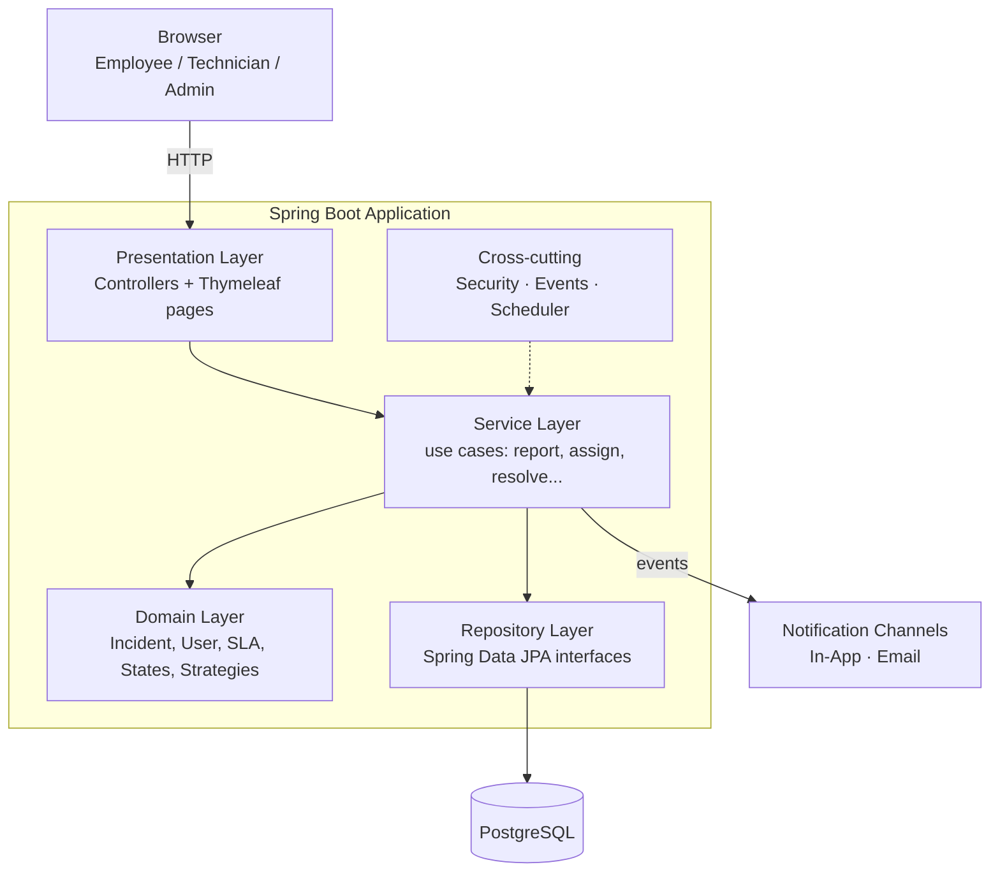
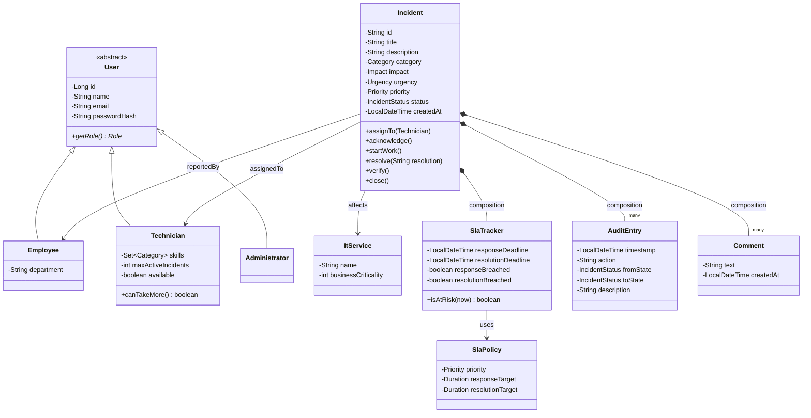
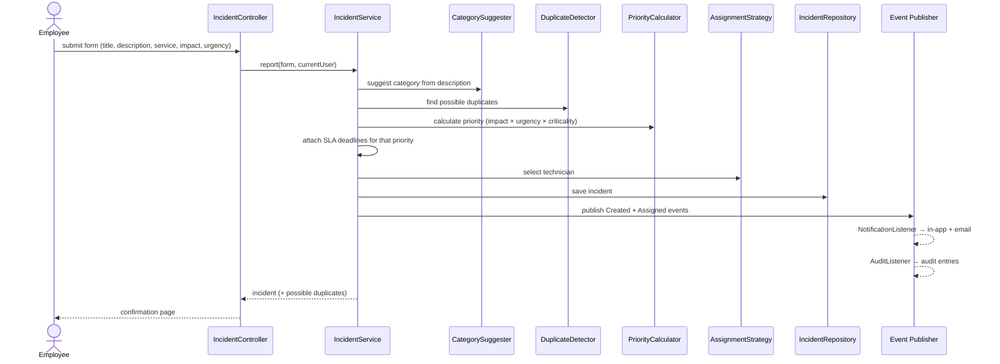

# I-ITSM — Architecture Plan

> Living design document for our OOP project. Every decision lists **what** we chose, **why**, and **what we rejected**.
> Much of this will be reused directly in the final report (Technology Selection Report, Architecture, UML sections).

**Team:** 3 members · **Background:** core Java, basic HTML/CSS · **Deadline:** 22 Nov 2026 · **Goal:** solid MVP + 1–2 innovation extras

---

## 1. Decisions at a glance

| Decision | Choice | One-line reason |
|---|---|---|
| Language | **Java 21+** | Course language; whole team already knows it |
| Application type | **Web app (server-rendered)** | Multi-role UI in a browser; no install for users |
| Backend framework | **Spring Boot** | Industry-standard Java framework; handles web, DB, security, scheduling for us |
| UI / frontend | **Thymeleaf templates + Bootstrap 5** | Pages are plain HTML with a few extra attributes — matches our HTML/CSS skills |
| Charts | **Chart.js** | One `<script>` tag, gives the dashboard real charts |
| Database | **PostgreSQL** (H2 in-memory for automated tests) | Real relational DB; our data is highly relational |
| DB access | **Spring Data JPA (Hibernate)** | Implements the Repository pattern for us; maps classes ↔ tables |
| Security | **Spring Security** | Login, BCrypt password hashing, role-based access out of the box |
| Background jobs | **Spring `@Scheduled`** | Periodic SLA checks and auto-escalation |
| Build tool | **Maven** | Most tutorials use it; dependency management |
| Testing | **JUnit 5 + Mockito** | Standard Java testing tools |
| Version control | **Git + GitHub** | Required deliverable |
| Architecture style | **Layered monolith** | Simple to build, test, and explain; clear separation of concerns |

---

## 2. Why this stack (and what we rejected)

### The constraint that drives everything
We have ~26 days, 3 people, and nobody has used a web framework. Every extra technology is something to *learn* before we can *build*. So the rule is: **minimise the number of new things, and make each new thing earn its place.**

### Why Spring Boot + Thymeleaf (server-rendered pages)
In a server-rendered app, the Java backend builds the full HTML page and sends it to the browser. A Thymeleaf template is just an HTML file:

```html
<tr th:each="inc : ${incidents}">
  <td th:text="${inc.id}">INC1001</td>
  <td th:text="${inc.priority}">P1</td>
</tr>
```

That is the only "frontend framework" we need to learn. Everything else is Java.

**Rejected: React frontend + Spring REST API.** This is the "modern" look, but it means learning JavaScript, React, REST design, JSON, CORS, and token auth (JWT) — *before* building a single feature. Two languages and two codebases for a 3-person team with no JS experience is the single biggest risk to finishing. We can still expose a few REST endpoints later (e.g. for dashboard charts) to show API skills.

**Rejected: JavaFX desktop app.** Pure Java, but desktop UI code is verbose, multi-user login over a shared DB is awkward, and it looks dated in the demo. The rubric also rewards modern platforms.

**Rejected: plain Java servlets/JDBC with no framework.** We'd hand-write things Spring gives us for free (request routing, SQL mapping, login security). That time is better spent on the graded parts: OOP design and features.

### Why PostgreSQL
Our data is naturally **relational**: an incident *belongs to* a reporter, *is assigned to* a technician, *affects* a service, *has many* audit entries. Relational databases with foreign keys model this directly and protect consistency.

**Rejected: MongoDB.** Document databases suit loosely structured data; ours is tightly structured with many relationships. (MySQL would be equally fine — if a teammate already has MySQL installed, switching is a one-line config change. That's a benefit of JPA.)

We use **H2 (in-memory)** for automated tests so tests run fast and don't need a database server.

### How this stack supports OOP (report question #8)
Our business logic lives in **plain Java classes** (the domain layer — see §3). Spring and JPA *wire objects together* (dependency injection) and *persist* them, but they don't dictate our class design. Dependency injection actually *encourages* good OOP: classes depend on **interfaces**, and Spring plugs in the implementation.

### How it would scale (report question #9)
- Short term: run multiple copies of the app behind a load balancer (the app is stateless apart from login sessions); add DB indexes on status/priority/created date.
- Medium term: move notifications to a message queue (e.g. RabbitMQ) so slow emails don't block requests.
- Long term: split heavy modules (notifications, analytics) into separate services. Our layered design with interfaces makes this split possible without rewriting the domain logic.

---

## 3. Architecture: layered design



### What each layer does

| Layer | Job | Example | Must NOT do |
|---|---|---|---|
| **Presentation** | Receive HTTP requests, validate form input, pick which page to show | `IncidentController.reportIncident(form)` | Contain business rules |
| **Service** | Coordinate a use case from start to finish | `IncidentService.report(...)` → classify, prioritise, assign, save, publish event | Generate HTML |
| **Domain** | The business objects and rules — **this is where the OOP marks are** | `incident.acknowledge()` throws if the state is wrong | Know about HTTP or SQL |
| **Repository** | Save and load objects | `incidentRepository.findByStatus(OPEN)` | Contain business rules |

### Why layers?
1. **Separation of concerns.** Each class has one kind of job, so it's easier to find, change, and test. If we redesign a page, the priority calculation doesn't change.
2. **Dependencies point downward only.** Controllers know about services; services know about the domain; the domain knows about nothing above it. This keeps the core logic independent and testable without starting a web server.
3. **Parallel work.** One person can build pages while another builds services, agreeing only on service method signatures.
4. **Easy to explain** in the report and demo — the rubric gives 10 marks to architecture.

**Rejected: microservices.** Many deployable services, network calls between them, distributed data — enormous overhead for 3 people and no benefit at our scale. We'll mention it as a future evolution (§2).

---

## 4. Package structure

```
com.itsm
├── web/                  ← Presentation: controllers, form objects (DTOs)
├── service/              ← Use cases: IncidentService, AssignmentService, SlaService, ReportService...
├── domain/
│   ├── user/             ← User (abstract), Employee, Technician, Administrator, Role
│   ├── incident/         ← Incident, Priority, Impact, Urgency, Category, AuditEntry, Comment
│   ├── incident/state/   ← IncidentState interface + one class per state  (State pattern)
│   ├── service/          ← ItService (the IT service affected, e.g. "Payments")
│   ├── sla/              ← SlaPolicy, SlaTracker
│   ├── assignment/       ← AssignmentStrategy interface + implementations (Strategy pattern)
│   ├── priority/         ← PriorityCalculator interface + implementation (Strategy pattern)
│   └── event/            ← IncidentEvent hierarchy (Observer pattern)
├── notification/         ← NotificationChannel interface, InApp/Email channels, factory, listener
├── intelligence/         ← DuplicateDetector, CategorySuggester, EscalationScheduler
├── repository/           ← Spring Data JPA interfaces
├── security/             ← Spring Security config, login handling
└── exception/            ← Custom exception hierarchy + global error handler
```

**Why organise by layer *and* by domain concept?** The top level shows the architecture (anyone can see the layers); the sub-packages under `domain/` keep related classes together so the class diagram maps cleanly onto the folders.

---

## 5. Domain model

### Core classes and relationships



### Why these relationships?

| Relationship | Where | Why this kind |
|---|---|---|
| **Inheritance** (is-a) | `Employee`, `Technician`, `Administrator` **is a** `User` | They genuinely share identity, login, and email, and differ in behaviour/permissions. The rubric warns: use inheritance *only* for true is-a. (We do **not** make `Incident` extend anything just to reuse code.) |
| **Composition** (owns, lifetime-bound) | `Incident` owns its `SlaTracker`, `AuditEntry` list, `Comment` list | An audit entry for INC1024 is meaningless without INC1024. If the incident is deleted, these go with it. |
| **Association / Aggregation** (uses, independent lifetime) | `Incident` → `Technician`, `Employee`, `ItService` | A technician exists before and after any incident. The incident just *refers* to them. |
| **Abstract class** | `User` | No one is "just a User" — every user has a specific role, so `User` can't be instantiated. |

### Encapsulation — the most important rule
`Incident` fields are **private** and there are **no public setters for `status`**. The only way to change status is through business methods like `acknowledge()`, which check the rules first. That way it is *impossible* for any code (a controller, a bug, a teammate) to put an incident into an illegal state.

```java
// ❌ Bad — anyone can break the lifecycle
incident.setStatus(IncidentStatus.CLOSED);

// ✅ Good — the object protects its own rules
incident.close();   // throws InvalidStateTransitionException if not VERIFIED
```

---

## 6. Design patterns (requirement: ≥ 2 — we'll use 6, each where it fits naturally)

Patterns are not decoration. Each one below solves a requirement that is **literally written in the assignment**.

### 6.1 State — incident lifecycle
**Requirement:** "the system must prevent inappropriate state transitions … should demonstrate appropriate object-oriented design."

**Without the pattern**, every method becomes a growing `if/switch`:
```java
void close() {
    if (status == NEW || status == ASSIGNED || status == IN_PROGRESS ...) throw ...;
}
```
Adding a new state (e.g. `ON_HOLD`) means editing every method.

**With the pattern**, each state is a class that knows which actions are legal *from that state*:
```java
public interface IncidentState {
    IncidentStatus status();
    default IncidentState assign()      { throw invalid("assign"); }
    default IncidentState acknowledge() { throw invalid("acknowledge"); }
    default IncidentState startWork()   { throw invalid("start work"); }
    default IncidentState resolve()     { throw invalid("resolve"); }
    default IncidentState verify()      { throw invalid("verify"); }
    default IncidentState close()       { throw invalid("close"); }
}

public class AssignedState implements IncidentState {
    public IncidentStatus status()         { return IncidentStatus.ASSIGNED; }
    public IncidentState acknowledge()     { return new AcknowledgedState(); }
    public IncidentState assign()          { return this; }  // re-assignment allowed
}
```
**Lifecycle:** `NEW → CLASSIFIED → ASSIGNED → ACKNOWLEDGED → IN_PROGRESS → RESOLVED → VERIFIED → CLOSED`
(plus `IN_PROGRESS ⇄ AWAITING_INFO` when the technician asks the employee for more details, and `RESOLVED → IN_PROGRESS` if the employee rejects the fix.)

**Practical detail:** the database stores the `IncidentStatus` **enum** (simple to save and search). The `Incident` converts it to the matching state object when it needs behaviour. Enum = *data*, state classes = *behaviour*.

### 6.2 Strategy — technician assignment (and priority calculation)
**Requirement:** "at least two assignment strategies … allow the strategy to be changed without redesigning the application."

```java
public interface AssignmentStrategy {
    Optional<Technician> selectTechnician(Incident incident, List<Technician> candidates);
}
class SkillBasedStrategy  implements AssignmentStrategy { ... }  // matching category skill, then least loaded
class LoadBasedStrategy   implements AssignmentStrategy { ... }  // fewest active incidents
class RoundRobinStrategy  implements AssignmentStrategy { ... }  // take turns
```
`AssignmentService` holds a reference to *an* `AssignmentStrategy` and never knows which one. The admin picks the active one from a dropdown. Adding a new strategy = adding one class; nothing else changes. That's the **Open/Closed Principle** (open for extension, closed for modification) — great to name in the report.

Same idea for `PriorityCalculator` — we ship a `WeightedPriorityCalculator` and could add a rule-based or ML one later.

### 6.3 Observer — notifications and audit
**Requirement:** notify people on many events; record every action; "easy to introduce another notification mechanism later."

When an incident is assigned, *several* things must happen: notify the technician, notify the reporter, write an audit entry, maybe update a dashboard. If `IncidentService` called each of those directly, it would depend on all of them and grow forever.

Instead, the service just **announces** what happened:
```java
eventPublisher.publishEvent(new IncidentAssignedEvent(incident, technician));
```
and independent **listeners** react: `NotificationListener`, `AuditListener`. Adding a new reaction (e.g. Slack) = a new listener; the service is untouched. We use Spring's built-in event system so we don't have to write the plumbing.

### 6.4 Factory — notification channel creation
`NotificationChannelFactory.get(ChannelType.EMAIL)` returns the right `NotificationChannel` implementation. Callers ask for a *type*, not a concrete class, so new channels plug in at one place.

### 6.5 Adapter — external email service
`EmailChannel` implements **our** `NotificationChannel` interface but internally calls Spring's `JavaMailSender` (a third-party API with a different shape). If we later switch to SMS via Twilio, we write a `TwilioSmsAdapter` — the rest of the system only ever sees `NotificationChannel`.

### 6.6 Repository — persistence
`interface IncidentRepository extends JpaRepository<Incident, String>`. Services ask the repository for objects and never write SQL. Spring Data generates the implementation. This keeps the domain independent of the database (and is why switching PostgreSQL ↔ MySQL is trivial).

---

## 7. Where each OOP concept appears (rubric checklist)

| Concept | Where in our design |
|---|---|
| Encapsulation | Private fields; status changed only via `Incident` business methods; `Technician.canTakeMore()` hides workload logic |
| Abstraction | `AssignmentStrategy`, `NotificationChannel`, `PriorityCalculator` hide *how* behind *what* |
| Inheritance | `User` → `Employee` / `Technician` / `Administrator`; `IncidentEvent` → specific events; custom exception hierarchy |
| Polymorphism | Any `AssignmentStrategy` / `NotificationChannel` / `IncidentState` used interchangeably; `user.getRole()` overridden |
| Interfaces | All strategy, channel, state, and repository contracts |
| Composition | `Incident` owns `SlaTracker`, `AuditEntry`s, `Comment`s |
| Association / Aggregation | `Incident` ↔ `Technician`, `Employee`, `ItService` |
| Exception handling | Custom exception hierarchy (§10) + global handler showing friendly error pages |
| Collections | `Set<Category>` for skills (no duplicates, fast lookup); `List<AuditEntry>` (ordered history); `PriorityQueue` of incidents by SLA deadline for the monitor; `Map<ChannelType, NotificationChannel>` in the factory; `EnumMap<Priority, SlaPolicy>` |

---

## 8. Key flow: an employee reports an incident



### Priority algorithm (documented, as required)
- **Impact** (1 = single user, 2 = department, 3 = organisation-wide)
- **Urgency** (1 = can wait, 2 = soon, 3 = work is blocked)
- **Business criticality** of the affected service (1–3, set by admin, e.g. Payments = 3)
- `score = impact × urgency × criticality` → range 1–27
- **P1** if score ≥ 18 · **P2** if ≥ 9 · **P3** if ≥ 4 · **P4** otherwise
- **Bump up one level** if affected users > 50 (configurable)

**Why multiplication?** A high value in *every* factor should dominate; a low value in any factor pulls the score down sharply — a minor issue on a critical service isn't automatically P1.

---

## 9. SLA monitoring & escalation

- When priority is set, `SlaTracker` stores **response** and **resolution deadlines** from the matching `SlaPolicy`.
- A **scheduled job** (`@Scheduled`, every minute) scans open incidents:
  - **≥ 75% of time used** → publish `SlaWarningEvent` (warning notification)
  - **past deadline** → mark breached, publish `SlaBreachedEvent`
  - **P1 not acknowledged in time** → **auto-escalate**: Technician → Team Lead → Admin
- Response time stops at **ACKNOWLEDGED**; resolution time stops at **RESOLVED**; time in **AWAITING_INFO** is paused (the delay is the employee's, not the technician's).

**Why a scheduler instead of checking on page load?** SLA breaches must be detected even when nobody is looking at the page. A background job is the only reliable way.

---

## 10. Exception design

```
ItsmException (abstract, extends RuntimeException)
├── InvalidStateTransitionException
├── UnauthorizedOperationException
├── ResourceNotFoundException     (incident, user, service not found)
├── TechnicianUnavailableException
├── WorkloadExceededException
├── SlaConfigurationMissingException
├── DuplicateIncidentException
└── ValidationException
```

**Why one common parent?** A single global handler (`@ControllerAdvice`) can catch any `ItsmException` and show a clear error page or message, while still letting us catch specific ones where we need special handling.

**Why unchecked (`RuntimeException`)?** These represent business-rule violations that the caller usually can't recover from locally; checked exceptions would force `throws` clauses through every layer. (Good point to justify in the report.)

---

## 11. Security

| Requirement | How |
|---|---|
| Authentication | Spring Security form login |
| Password protection | **BCrypt** hashing — we never store plain passwords |
| Role-based authorization | URL rules (`/admin/**` → ADMIN) + method checks (`@PreAuthorize`) |
| Protection against unauthorized ops | Services verify ownership: an employee can only view *their own* incidents; a technician can only resolve incidents *assigned to them* |
| Input validation | Bean Validation (`@NotBlank`, `@Size`) on form objects |
| CSRF | Enabled by default in Spring Security + Thymeleaf |

**Why check in the service layer too, not just hide buttons?** Hiding a button doesn't stop someone from typing the URL. Real protection must be on the server.

---

## 12. Database tables (first draft)

| Table | Key columns |
|---|---|
| `users` | id, name, email, password_hash, **role** (single-table inheritance), department, max_active_incidents, available |
| `technician_skills` | technician_id, category |
| `it_services` | id, name, business_criticality |
| `sla_policies` | priority, response_minutes, resolution_minutes |
| `incidents` | id, title, description, category, impact, urgency, priority, status, reporter_id, technician_id, service_id, created_at, response_deadline, resolution_deadline, breached flags, resolution, closed_at, feedback_rating |
| `audit_entries` | id, incident_id, user_id, timestamp, action, from_state, to_state, description |
| `comments` | id, incident_id, author_id, text, created_at, type (note / info-request / reply) |
| `notifications` | id, recipient_id, message, channel, read, created_at |
| `system_settings` | key, value (e.g. active assignment strategy) |

**Why single-table inheritance for users?** One `users` table with a `role` column is the simplest JPA inheritance mapping and makes login lookups one query. The few technician-only columns are just empty for other roles — acceptable at our scale.

---

## 13. Intelligent features

**Required: ≥ 2. We plan 3 core + 1 innovation extra.**

| Feature | Approach | Why chosen |
|---|---|---|
| **Duplicate detection** | Compare new incident's words with recent open incidents on the same service (Jaccard similarity on keywords after removing stop-words). Show "possible duplicates" and let the employee link instead of creating new | Directly needed for demo Workflow 3; pure Java, no external dependency |
| **Auto-escalation** | Scheduler escalates unacknowledged P1/P2 incidents up the chain | Reuses the SLA scheduler; very visible in the demo |
| **Category suggestion** | Keyword rules (`"vpn", "wifi"` → NETWORK, `"login", "password"` → AUTHENTICATION) | Cheap, explainable; pre-fills the form |
| *Innovation extra (if time)* | Replace keyword suggestion with an **LLM API call** behind the same `CategorySuggester` interface | Earns innovation + "third-party API" marks; interface means zero risk to the core |

Second innovation extra (if time): **real-time operational dashboard** with Chart.js (incidents by priority, SLA breaches, technician workload).

---

## 14. Team split (3 people)

Each person owns a vertical slice **and writes the tests for it**. Everyone must understand the whole system (required for the demo).

| Member | Owns | Also |
|---|---|---|
| **A — Domain & Intelligence** | Domain model, State pattern, Strategy (assignment + priority), duplicate detection, category suggestion, escalation | Class diagram |
| **B — Backend & Data** | Services, repositories, DB schema, Spring Security, SLA scheduler, notifications/events/audit | ER diagram, architecture diagram |
| **C — UI & Reporting** | Thymeleaf pages for all 3 roles, search/filters, dashboard & reports, error pages | Use case diagram, demo video script, test-case document |

**Why vertical slices?** Fewer merge conflicts and clear ownership. A and B agree on domain method signatures on day 1; B and C agree on service method signatures.

---

## 15. Timeline (27 Oct → 22 Nov)

| Week | Dates | Goal | Done when… |
|---|---|---|---|
| **1** | 27 Oct – 2 Nov | Learn basics + skeleton + domain model | Project runs; login works for 3 roles; domain classes + State pattern unit-tested |
| **2** | 3 – 9 Nov | Core incident flow end-to-end | Employee reports → priority → auto-assign → technician acknowledges → resolves → closes, all saved in DB |
| **3** | 10 – 16 Nov | SLA, notifications, audit, search, reports, intelligent features | **MVP complete** (60-mark section) |
| **4** | 17 – 22 Nov | Extras, testing, report, video | ≥15 test cases documented; report PDF; video recorded by **20 Nov** (2-day buffer) |

**Why this order?** The 60 functionality marks need a working end-to-end flow, so we build the thinnest complete path first (week 2) and widen it after. Extras come last so they can never block the MVP.

---

## 16. Next steps

1. Team reviews this document; agree or flag changes.
2. Generate the project skeleton (Spring Initializr: Web, Thymeleaf, JPA, Security, Validation, PostgreSQL, H2).
3. Create the GitHub repo and share access.
4. Everyone completes a short Spring Boot intro (one guide: "Serving Web Content with Spring MVC" on spring.io).
5. Member A starts the domain model + State pattern with unit tests (pure Java — no Spring knowledge needed yet).

---

## 17. Implementation notes (what was actually built)

The implementation follows this plan. Where it differs, the reason is recorded here.

| Plan | Built | Why |
|---|---|---|
| Spring Boot 3 | **Spring Boot 4.1** on Java 21 | Current stable release at build time; same programming model |
| Schema via JPA | **Flyway** migration `V1__schema.sql`, Hibernate `ddl-auto=none` | The schema is a deliverable; versioned SQL is reviewable and identical on every machine |
| 3 assignment strategies | **4**: Skill, Load, Round-robin, Smart (weighted, explainable) | Smart recommendation doubles as an intelligent feature |
| 1 priority calculator | **2**: Weighted (default) and ITIL matrix | Demonstrates the Strategy pattern for priority too |
| Team lead role | `teamLead` flag on `Technician` | A team lead *is a* technician; no new subclass needed |
| Email + in-app | **4 channels**: in-app, live push (SSE), email (simulated or SMTP), SMS (simulated) | Brief asks for at least 2; Factory makes adding channels trivial |
| LLM categoriser (stretch) | Gemini adapter with offline TF-IDF fallback, used for categorisation, quick report and resolution advice | The app never depends on the network to work |
| Chart.js dashboard (stretch) | Live dashboard (SSE refresh), reports page, service dependency map | Innovation marks |
| — | Service dependency graph + correlation engine, predictive SLA risk, knowledge-base suggestions, "me too" duplicate folding | Innovation marks; all explainable algorithms (see DESIGN.md §6) |
| — | REST API + Swagger, CSV export, Dockerfile, docker-compose, GitHub Actions CI | Technical depth marks |

Detailed UML, ER and algorithm descriptions: [DESIGN.md](DESIGN.md).
